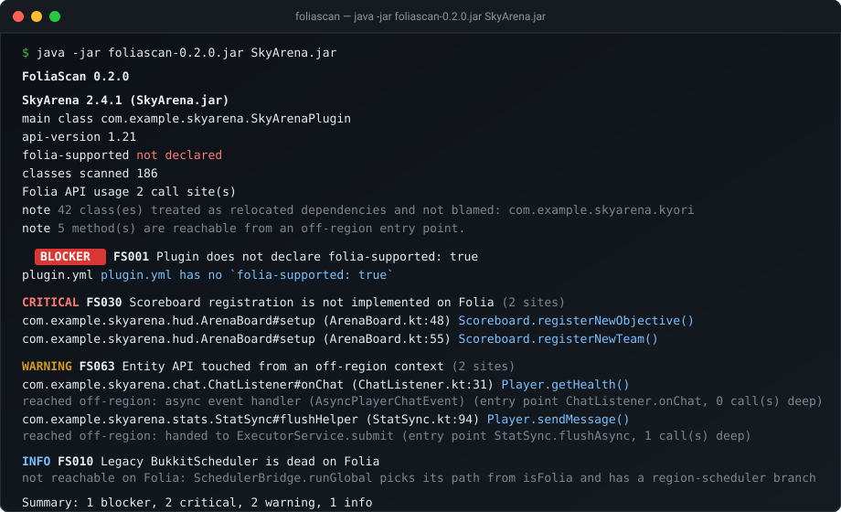
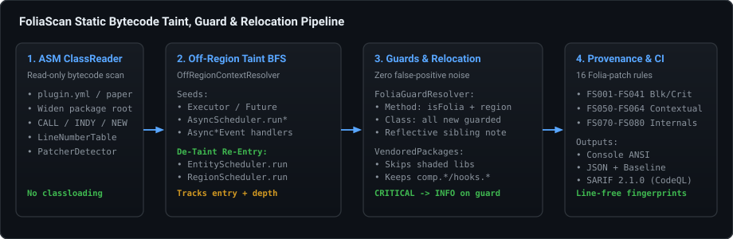

# FoliaScan

Tell whether a Minecraft plugin jar will actually survive on [Folia](https://github.com/PaperMC/Folia)
- by reading its bytecode, not its README.



Works on any jar - including one you did not compile. Server owners can check a paid plugin
before installing it; developers can gate a release in CI and surface regional thread-safety bugs
directly in GitHub's **Security -> Code scanning** tab.

**[Open Browser Drag-and-Drop JAR Scanner](https://salyys1.github.io/foliascan/)** | **[GitHub Action (`uses: SalyyS1/foliascan@main`)](#in-ci)** | **[CLI Releases](https://github.com/SalyyS1/foliascan/releases)**



## Why this exists

Folia's threading changes are not gradual. Some very ordinary Bukkit calls stop working
completely, and nothing tells you until a player triggers the code path:

- **The entire legacy scheduler is dead.** Folia inserts an unconditional
  `if (true) throw new UnsupportedOperationException()` into `CraftScheduler#handle`, so every
  `runTask`, `runTaskLater`, `runTaskTimer` and async variant throws. Not "on the wrong
  thread" - always.
- **The Scoreboard API is not implemented.** `registerNewObjective`, `registerNewTeam`,
  `clearSlot`, `getNewScoreboard` and `Player#setScoreboard` all throw unconditionally. Every
  scoreboard HUD, stat sidebar and team system breaks.
- **Runtime world creation is gone.** `createWorld` and `unloadWorld` throw.
- **Synchronous teleports are rejected** with `Must use teleportAsync while in region threading`.
- **`Entity`, `World`, `Block` and `BlockState` calls are region-guarded.** Folia wraps
  `CraftEntity#getHandle` - and ~170 subclass overrides - in a thread check, so touching an
  entity from a thread that does not own it throws.

Adding `folia-supported: true` silences the loader, not the exceptions. FoliaScan finds the
call sites that will still blow up.

## Browser JAR Scanner (Zero Upload)

Inspect one `.jar` or drop an entire server `plugins/` directory directly in your browser at
**[https://salyys1.github.io/foliascan/](https://salyys1.github.io/foliascan/)**:

- Unpacks ZIP headers and `0xCAFEBABE` JVM class constant pools locally using `ArrayBuffer` and
  `DecompressionStream('deflate-raw')` with zero network uploads and zero external CDNs.
- Evaluates `paper-plugin.yml` / `plugin.yml` (`FS001`), automated bytecode patcher markers
  (`FS002`), unconditional Folia crashes (`FS010` through `FS041`), NMS internals (`FS070`), and
  `isPrimaryThread` gates (`FS080`), skipping shaded vendor packages unless toggled on.
- Renders a multi-JAR Server Compatibility Matrix (`PASS`, `PATCHED`, `FAIL`) with Markdown and
  JSON export, plus a 1-click synthesized sample plugin `.jar` for instant testing.

For full intra-jar call-graph async taint propagation (`FS050` through `FS065`, `FS081` concurrency audit, `FS082` through `FS086` cross-region and lifecycle rules, `FS087` through `FS090` Moonrise async chunk generation and block-entity rules, and `FS111` through `FS115` Paper/Folia 26.3 DataComponentHolder, shared inventory, regional scoreboard, and Leashable rules),
baseline files, and OASIS SARIF v2.1.0 output (`codeFlows` + regional taint call-chain paths), run
the CLI or GitHub Action below.

## Install

Requires Java 21+.

Download `foliascan-<version>.jar` from
[Releases](https://github.com/SalyyS1/foliascan/releases) and run it:

```bash
java -jar foliascan-1.1.0.jar MyPlugin.jar
```

Or build from source:

```bash
./gradlew build          # runs the test suite too
java -jar build/libs/foliascan-1.1.0.jar MyPlugin.jar
```

## Usage

```
foliascan [OPTIONS] TARGET...

  TARGET                          plugin jar(s), or a directory of jars

  --format console|json|sarif     output format (default: console)
  -o, --output PATH               write the report to a file
  --sarif PATH                    write an OASIS SARIF 2.1.0 report to PATH
  --fail-on LEVEL                 blocker|critical|warning|info|never (default: critical)
  --all                           report relocated dependency packages too
  --include PACKAGE               only scan this package (repeatable)
  --exclude PACKAGE               skip this package (repeatable)
  --disable RULE_ID               turn a rule off (repeatable)
  --baseline FILE                 suppress findings listed in FILE
  --write-baseline FILE           record current findings as accepted, then exit 0
  --no-color                      plain output
  -v, --verbose                   list every call site instead of the first 8
  --rules                         print the rule catalog with sources, then exit
  --benchmark                     run the synthetic multi-class bytecode benchmark suite and exit
  --benchmark-runs INT            timed passes for --benchmark (default: 20)
```

Exit codes: `0` clean at the chosen threshold, `1` findings at or above it, `2` bad usage.

Scan a whole server directory or emit a SARIF v2.1.0 report alongside console output:

```bash
foliascan /srv/mc/plugins --fail-on blocker
foliascan build/libs/MyPlugin.jar --sarif foliascan.sarif
```

### In CI (GitHub Code Scanning + SARIF v2.1.0)

Gate any Paper, Folia, or Spigot repository and publish Folia thread-safety bugs natively to the
GitHub **Security -> Code scanning** tab in 10 lines using the composite GitHub Action and
`github/codeql-action/upload-sarif`:

```yaml
permissions:
  contents: read
  security-events: write
steps:
  - uses: SalyyS1/foliascan@v1.1.0
    with:
      jar: build/libs/*.jar
      sarif-file: foliascan.sarif
  - uses: github/codeql-action/upload-sarif@v3
    if: always()
    with:
      sarif_file: foliascan.sarif
```

The action caches `foliascan-<version>.jar`, publishes a Markdown compatibility matrix to
`$GITHUB_STEP_SUMMARY`, writes OASIS SARIF v2.1.0 (with `tool.driver` metadata, deduplicated rule
help, `%SRCROOT%` source paths, bytecode line numbers, and `codeFlows` regional taint call chains),
and exits with FoliaScan's threshold exit code.

| Input | Default | Purpose |
| --- | --- | --- |
| `jar` | *(required)* | Plugin JAR path(s), glob pattern(s), or directory of JARs |
| `fail-on` | `critical` | Lowest severity that exits non-zero (`blocker`, `critical`, `warning`, `info`, `never`) |
| `baseline` | `""` | Baseline JSON file path used to suppress accepted findings |
| `disable` | `""` | Comma- or space-separated rule IDs to turn off (for example `FS063,FS070`) |
| `all` | `false` | Report relocated third-party dependency packages too |
| `sarif-file` | `""` | Optional output file path for a SARIF 2.1.0 report (also exposed as `outputs.sarif-file`) |
| `version` | `1.1.0` | FoliaScan release version to download and cache |

Or invoke the CLI JAR directly in any CI runner:

```yaml
- name: Check Folia compatibility
  run: |
    java -jar foliascan-1.1.0.jar build/libs/*.jar \
      --sarif foliascan.sarif --fail-on critical
```

Adopting on a large legacy plugin? Record what exists today and fail only on new problems:

```bash
foliascan MyPlugin.jar --write-baseline foliascan-baseline.json   # once
foliascan MyPlugin.jar --baseline foliascan-baseline.json         # every build
```

Fingerprints deliberately exclude line numbers, and Baseline v2 records SHA-256 structural hashes
that normalise javac and kotlinc synthetic lambda ordinal suffixes (`lambda$foo$0` -> `lambda$foo$*`),
so editing code or adding lambdas above a call site does not resurrect a suppressed finding.

## Rules

Run `foliascan --rules` for the full text of each one, including the Folia source it came from.

| Id | Severity | What it catches |
|----|----------|-----------------|
| FS001 | blocker | descriptor missing `folia-supported: true` - Folia refuses to load the plugin |
| FS002 | warning | the `folia-supported` flag was written by a patcher, not by the author |
| FS010 | critical | `Bukkit.getScheduler()` / `Server#getScheduler()` |
| FS011 | critical | any call on `BukkitScheduler`, including via a stored field |
| FS012 | critical | class extends `BukkitRunnable` |
| FS020 | critical | synchronous `Entity#teleport` |
| FS030 | critical | `Scoreboard#registerNewObjective` / `registerNewTeam` / `clearSlot` |
| FS031 | critical | `ScoreboardManager#getNewScoreboard`, `Player#setScoreboard` |
| FS040 | critical | `createWorld`, `unloadWorld` |
| FS041 | critical | `World#getTickableTileEntityCount` |
| FS050 | warning | `getTPS`, `getAverageTickTime` read off-region |
| FS051 | warning | `dispatchCommand` off-region |
| FS060 | warning | region-guarded `World` calls (`getChunkAt`, `loadChunk`, `unloadChunk`, `createExplosion`, `setBiome`, ...) |
| FS061 | warning | region-guarded `Block` calls (`getType`, `setType`, `getBlockData`, `setBlockData`, `getBlockState`, `breakNaturally`, ...) |
| FS062 | warning | region-guarded `BlockState` calls (`update`, `getDrops`, `randomTick`) |
| FS063 | warning | any `org.bukkit.entity` call from an off-region context |
| FS064 | warning | global-region-guarded `World` calls (`setTime`, `setStorm`, `setGameRule`, `setChunkForceLoaded`, `setMetadata`, ...) |
| FS065 | warning | region-guarded `Chunk` (`getEntities`, `getTileEntities`, `getBlock`, `load`) and `World` entity-query / rayTrace / spawn calls |
| FS070 | warning | direct `net.minecraft` / `org.bukkit.craftbukkit` access, one finding per class |
| FS080 | info | `isPrimaryThread()` used as a safety gate |
| FS081 | warning | unsynchronized static `HashMap` / `ArrayList` / `HashSet` mutated inside concurrent Folia region or async tasks |
| FS082 | warning | cross-region passenger attachment or vehicle ejection (`addPassenger`, `removePassenger`, `eject`, `leaveVehicle`) off-region |
| FS083 | warning | `EntityScheduler#runDelayed` / `runAtFixedRate` submitted with `null` retired callback |
| FS084 | warning | unchained `Entity#teleportAsync` discarding `CompletableFuture` before subsequent entity access |
| FS085 | warning | `Bukkit.getOnlinePlayers()` iterated from an off-region context without per-player `EntityScheduler` dispatch |
| FS086 | warning | synchronous cross-region `HumanEntity#openInventory` / container access off-region |
| FS087 | warning | blocking `join()` / `get()` / `resultNow()` on `World#getChunkAtAsync*` or `Entity#teleportAsync` region-completed futures |
| FS088 | warning | live `World` cast or lookup inside Moonrise parallel async `ChunkGenerator` or `BlockPopulator` worker callbacks |
| FS089 | warning | `TileState`, `Container`, or Paper 26.3 block-entity (`Chest`, `Sign`, `TrialSpawner`, `Vault`, `Crafter`, ...) accessed off-region |
| FS090 | warning | pre-fetched `BlockState` or `TileState` snapshot captured across delayed `RegionScheduler` ticks or `EntityScheduler` callbacks |
| FS091 | warning | `PersistentDataContainer` mutation (`set`, `remove`, `readFromBytes`, `copyTo`) from off-region or async context |
| FS092 | warning | `Structure#place` multi-block template paste across potentially unbounded regional chunk boundaries |
| FS093 | warning | `Bukkit.createInventory` with world-bound `TileState` or `Entity` holder off-region |
| FS094 | warning | `BossBar` player list mutation (`addPlayer`, `removePlayer`, `removeAll`) off global region |
| FS095 | warning | `WorldBorder` configuration mutation (`setCenter`, `setSize`, ...) from regional tick thread |
| FS096 | warning | `MapView` renderer or world configuration mutated off global region |
| FS097 | warning | `Bukkit.broadcastMessage` / `Server#broadcast` called from regional or async context |
| FS098 | warning | `ServicesManager#register` / `unregister` / `unregisterAll` mutated asynchronously |
| FS099 | warning | `PluginManager#registerEvents` / `unregisterEvents` / `unregisterAll` mutated off global tick |
| FS100 | warning | `BlockData` state setters invoked from async context before `Block#setBlockData` |
| FS101 | warning | unconfined Kotlin coroutine `DelayKt#delay` / `Dispatchers.Unconfined` suspension or off-region `Continuation#resumeWith` |
| FS102 | warning | `Bukkit.selectEntities` / `Server#selectEntities` vanilla target selector evaluated off-region |
| FS103 | warning | `Inventory`, `PlayerInventory`, or `EntityEquipment` slot mutation off-region |
| FS104 | critical | runtime `Bukkit.reload` / `Bukkit.reloadData` (`UnsupportedOperationException` on Folia) |
| FS105 | warning | unsynchronized instance `HashMap` / `ArrayList` / `HashSet` field mutated across concurrent Folia tasks |
| FS106 | warning | `Entity` / `Player` captured into `Location`-keyed `RegionScheduler` closure and mutated without `isOwnedByCurrentRegion` |
| FS107 | warning | live `Chunk` instance captured across `RegionScheduler#runDelayed` / `runAtFixedRate` or `EntityScheduler` closure |
| FS108 | warning | Scoreboard `Team`, `Objective`, or `Score` state mutated off global region |
| FS109 | warning | `AdvancementProgress#awardCriteria` / `revokeCriteria` mutated off-region |
| FS110 | warning | `LootTable#fillInventory` / `populateLoot` evaluated off-region |
| FS111 | warning | Paper 26.3 `DataComponentHolder` or live container/equipment `ItemStack` component mutated off-region |
| FS112 | warning | shared `Inventory` or `Merchant` field mutated concurrently across Folia regional or async schedulers |
| FS113 | warning | open `InventoryView` slot, cursor, or title mutated from an off-region context |
| FS114 | warning | Scoreboard `Team`, `Objective`, `Score`, or `resetScores` mutated across parallel regional schedulers |
| FS115 | warning | cross-region Paper 26.3 `Leashable#setLeashHolder` attachment without dual-entity `isOwnedByCurrentRegion` guard |

Severities mean specific things:

- **blocker** - the plugin will not load at all.
- **critical** - Folia throws whenever the code runs, on any thread. Reported unconditionally,
  unless the code is behind a Folia guard, in which case it drops to info.
- **warning** - legal from the region that owns the data, fatal from anywhere else. Only
  reported when the call sits in a context FoliaScan can show is off-region.
- **info** - behaviour differs enough to need a human decision.

FS070 is deliberately counted per class rather than per call site. An NMS adapter or model engine
touches server internals thousands of times by design, and enumerating each one buries every other
finding, so the finding carries the distinct type count instead.

## How it works

1. Parse every class with ASM. Nothing is loaded or executed, and no bytecode is written.
2. Read `paper-plugin.yml` / `plugin.yml` for the descriptor, then work out the plugin's own
   package(s). `main` alone is not enough - plugins commonly park the entry class in a platform
   subpackage (`dev.aurelium.auraskills.bukkit.AuraSkills`) while most of the code lives in
   sibling packages, and forks often keep the legacy `main` package for addon compatibility while
   placing new code under `<tld>.<author>.<PluginName>` (e.g. `GravesX` keeping
   `com.ranull.graves.Graves` alongside `dev.cwhead.GravesX`). FoliaScan widens `main`'s root and
   includes packages matching the descriptor's plugin name. The report prints the roots it chose
   and how many of the jar's classes they cover.
3. Find off-region entry points: a lambda or `Runnable` handed to an executor, a
   `CompletableFuture` async stage (plus non-async `thenAccept` / `thenApply` / `thenRun`
   continuations chained onto `supplyAsync` or `runAsync`, while sparing Folia-safe futures like
   `Entity#teleportAsync`), a raw `Thread`, `java.util.Timer`, `runTask*Asynchronously`, Paper's
   `AsyncScheduler`, a Bukkit/Paper async event handler (`AsyncPlayerChatEvent`,
   `AsyncChatEvent`, `AsyncPlayerPreLoginEvent`, `AsyncPlayerConnectionConfigureEvent`), a
   ProtocolLib / PacketEvents / Netty channel packet callback running on Netty I/O threads, or a
   `GlobalRegionScheduler` callback (`region={null}`, which owns global server/world state
   `FS050`/`FS064` but owns no chunks, blocks, or entities `FS060` through `FS063` and `FS065`).
4. Propagate that breadth-first across in-jar call edges, recording every call-site hop and
   bytecode line number so helpers called from async tasks carry the complete regional taint call
   chain (emitted in human messages and SARIF `codeFlows` / `threadFlows`). Callbacks inside an
   async method that hop back onto `EntityScheduler` or `RegionScheduler` are recognised as
   regional re-entries and do not inherit off-region taint.
5. Find the Folia guards, so the correct non-Folia branch of a dual-platform plugin is not
   reported as a defect (below).
6. Apply the rule table, keeping one finding per source line.

### Dual-platform code is not a defect

A plugin that supports both servers has to contain legacy calls, and they are correct precisely
because they never run on Folia. FoliaScan looks for the guard and downgrades a critical finding
to **info** when it finds one, naming the guard instead of muting the finding. Both shapes real
plugins use are recognised:

```kotlin
// per method - one class, one flag, a branch in every method
fun runGlobal(task: Runnable) =
    if (isFolia) Bukkit.getGlobalRegionScheduler().run(plugin) { task.run() }
    else Bukkit.getScheduler().runTask(plugin, task)

// per class - one interface, two implementations, chosen once at startup
val scheduler = if (IS_FOLIA) PaperScheduler() else BukkitScheduler()
```

A method qualifies when it both tests for Folia *and* contains a region-scheduler call; the second
half is what stops this from muting everything, since unconditional legacy code has no region call
to pair with the test. FoliaScan recognises `folia` flags, `ServerBuildInfo#isBrandCompatible`, and
PaperMC's canonical `Class.forName("io.papermc.paper.threadedregions.RegionizedServer")` probe even
when stored in a neutrally named static boolean (`HAS_REGIONS`) or helper (`supportsRegions()`). A
class qualifies when every `new` of it sits in a method that tests for
Folia - and the test has to be independent of the class itself, or anything named `FoliaScheduler`
would vacuously guard itself. Lambdas created inside a guarded method inherit the guard, because a
task built in the legacy branch compiles into its own synthetic method.

Two limits, stated rather than hidden: a class built reflectively or by a DI container has no
visible `new`, so it stays reported; and there is no control-flow analysis, so a method that tests
for Folia and *also* calls the legacy scheduler outside the branch is treated as guarded. The first
errs toward reporting, the second away from it.

FoliaLib is the case that defeats both shapes, and it is worth knowing about because it is the
library most Folia-targeting plugins reach for. Its factory does
`Class.forName(basePackage + implName)`, so nothing ever writes `new SpigotImplementation()` and no
method of that class tests for Folia - the test lives in the factory, one indirection away, keyed by
a string. What is still visible is the shape: a class this jar never constructs, sitting next to a
sibling implementation of the same interface that does use the region API. That earns an explanation
naming the sibling, and **no change in severity** - it is suggestive, not proof, and a wrong
all-clear costs more than a wrong warning.

Relocated dependencies are analysed but not blamed. A compatibility shim like FoliaLib
deliberately contains a legacy `BukkitScheduler` implementation for non-Folia servers, so
reporting it is noise; the code still counts toward "Folia API usage" and still taints the plugin
code it calls. Two signals identify it: build-tool folder names (`libs`, `shaded`, `vendor`, ...)
and a curated list of library leaf names, because relocation often leaves no marker folder at all
(`dev.aurelium.auraskills.kyori`). That list is necessarily incomplete, so every subtree it
matches is named in the report notes, `--exclude` adds your own, and `--all` turns it off.

Only segments *below* the plugin's own root count, and a jar with no plugin descriptor is never
filtered at all - otherwise pointing the scanner at one of those libraries directly would
exonerate the whole jar. Scanning `IF-0.12.0.jar` should report the two
`Bukkit.getScheduler().runTask` calls in its `GuiListener`, not "no findings" just because
`inventoryframework` is a name plugins shade. The same rule is what keeps MythicLib's own
`io.lumine.mythic.lib` from reading as a relocation folder because it ends in `lib`.

A name match is also skipped when the segment before it says "adapter": plugins name their own
integration packages after the library they integrate with, so `comp.protocollib` and
`hooks.placeholderapi` are the plugin's code, not a copy of the library. The search continues
past it, so a library genuinely relocated deeper (`compat/libs/kyori/...`) is still found.

Every entry on the name list has to be a library *identity* rather than a domain noun, for the
same reason. Measured over eleven real plugin jars plus a Prometheus exporter, `nbt`,
`annotations`, `mysql`, `sqlite` and `metrics` only ever matched plugins' own packages and were
removed - `metrics` hid all four critical findings in an exporter whose entire job is metrics,
including a `scheduleSyncRepeatingTask` call. `internal` and `external` went too: no build tool
generates either, and plugins use both constantly. Deleting the list wholesale is not the answer
either, since one jar that relocates without any marker folder (`dev.aurelium.auraskills.acf`,
`.kyori`) then produces 74 findings on clean code.

## Related tools

FoliaScan reports; it does not modify your jar.

**[FoliaPhantom / pasta](https://github.com/MARVserver/pasta)** (MIT) rewrites plugin bytecode to
route legacy scheduler calls through its own shim. Different job, and useful if you want a server
to boot today. Two things to know if you use it: `PluginPatcher#modifyPluginDescriptor` appends
`folia-supported: true` unconditionally, without analysing whether the result is region-safe, and
its own README disclaims thread-safety guarantees. So a patched jar's declared flag is a machine's
assumption, not the author's claim - which is what rule **FS002** exists to surface. FoliaScan
detects the runtime classes pasta bundles and says so instead of trusting the flag.

**[folia-checker](https://github.com/IronDiscipline-Project/folia-checker)** (MIT) is a VS Code
extension applying line-by-line regular expressions to `.java` sources. Source-only, Java-only,
and regex granularity means it cannot separate `runTaskAsynchronously` from `runTask` without
hand-tuned patterns.

**[FoliaLib](https://github.com/technicallycoded/FoliaLib)** and similar are runtime helper
libraries: they help you *write* Folia-compatible code. FoliaScan tells you whether you already
did. They compose - a jar bundling FoliaLib scans clean, because relocated shim code is analysed
but not blamed.

## What it does not do

Worth reading before treating a clean run as a guarantee.

- **A clean result is not a proof of correctness.** It means none of the enabled rules matched.
- **Calls leaving the jar are not followed.** If an async entry point lives in a dependency and
  calls back into your code by interface, the taint can be missed.
- **Reflection, injected executors and thread pools obtained from other plugins are invisible.**
- **A helper used from both sync and async callers is reported.** That is intentional - it
  genuinely may run off-region - but it is not always a bug.
- **`--fail-on critical` only judges unconditional failures.** Region-guarded misuse that
  FoliaScan cannot place in an off-region context will not appear at all.
- Findings need line numbers to be actionable; a jar stripped of debug info still gets class and
  method attribution, but no lines.

## Where the rules come from

Every rule cites a file and member inside Folia's own patch set, printed with each finding and
listed by `foliascan --rules`. The dataset behind the table was extracted mechanically, not
recalled: `tools/extract_folia_throws.py` walks a Folia checkout and reports every added
`throw new UnsupportedOperationException`, every `TickThread.ensureTickThread` guard, and the
`@Deprecated` marker on `BukkitScheduler`.

```bash
git clone --depth 1 https://github.com/PaperMC/Folia.git /tmp/folia
python tools/extract_folia_throws.py /tmp/folia
```

Re-run it when Folia changes to check the table is still accurate. Rules were verified against
Folia at the 1.21.11 branch state on 2026-08-22.

No Folia or Paper source is vendored, copied or redistributed here. The rule table references
class and member names and quotes short diagnostic strings so that each claim can be audited.

FoliaScan is an independent tool and is not affiliated with or endorsed by PaperMC.

## Companion Minecraft Toolchain

FoliaScan is part of a focused static-analysis, staging, resource-pack, and coding-agent suite by
[SalyVn](https://github.com/SalyyS1):

| Project | Role |
| --- | --- |
| [minecraftkit](https://github.com/SalyyS1/minecraftkit) | Offline RPG and Paper/Folia API catalog, 10 `/mc:*` skills for Claude Code and Codex, [web API explorer](https://salyys1.github.io/minecraftkit/), and stdio MCP server |
| [serverdoctor](https://github.com/SalyyS1/serverdoctor) | Offline server diagnostics across logs, configs, JVM flags, plugin sets, worlds, crash reports, and access lists (CLI + MCP) |
| [pluginscope](https://github.com/SalyyS1/pluginscope) | Static audits for plugin JAR packaging, shading/relocation, Paper API version compatibility, plugin stacks, and resource packs (CLI + MCP) |
| [mcstage](https://github.com/SalyyS1/mcstage) | Standalone integration harness that boots real Paper, Folia, and Purpur servers, drives console commands, and asserts on logs |
| [glyphsmith](https://github.com/SalyyS1/glyphsmith) | Deterministic Minecraft font glyph packer solving ascent, padding, advance, and negative-space shifts into a resource pack |

## Contributing

New rules need a provenance entry pointing at the Folia source that justifies them, plus a
fixture in `src/test/kotlin/fixtures/` proving both that the rule fires on bad code and that it
stays quiet on the region-aware equivalent. Rules without evidence will not be merged - the
value of this tool is that its output can be checked.

```bash
./gradlew test
```

## License

[Apache-2.0](LICENSE). See [NOTICE](NOTICE) for third-party attributions.
